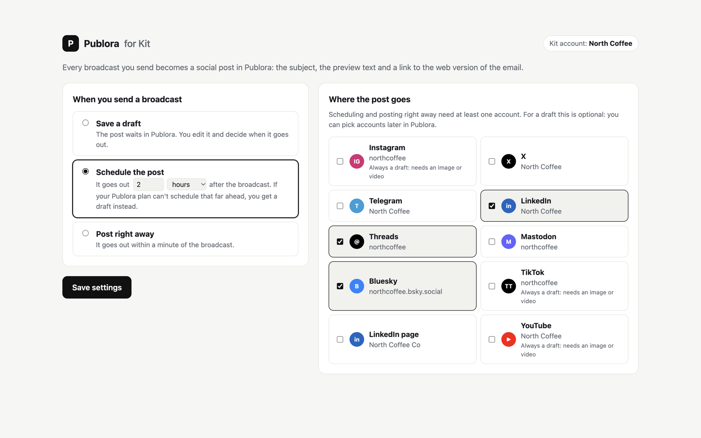
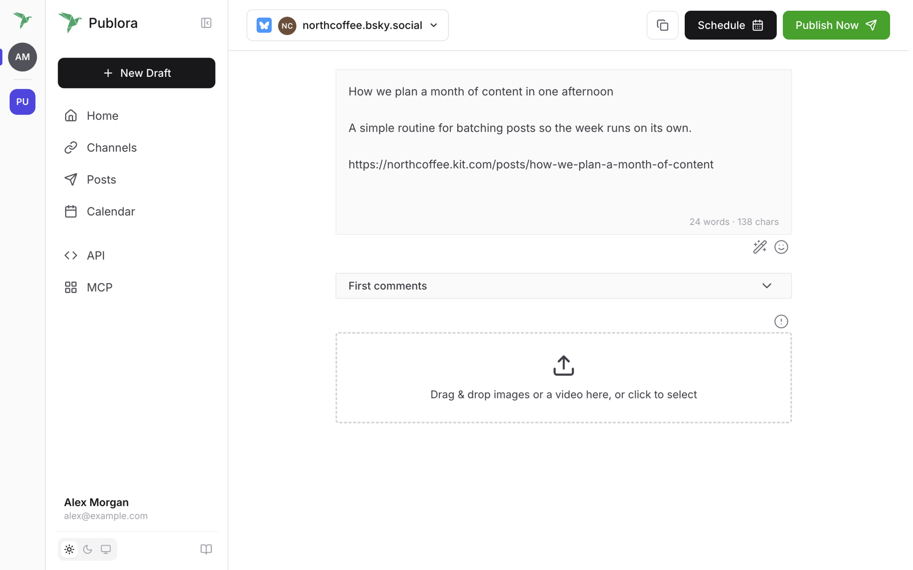

# Kit App

Publora has an app in the Kit App Store. Once it's installed, every broadcast you send from Kit becomes a post in Publora: the subject, the preview text and a link to the web version of the email. You choose whether that post waits as a draft, goes out at a set time after the broadcast, or goes out right away.

There's nothing to code and no API key to copy. The app signs in to Publora and Kit for you.

## Before you start

- A Kit account on a plan that includes apps. Kit's free plan doesn't.
- A Publora account with at least one connected social account. The free plan is enough.

## Step 1 — Install the app

In Kit, open **Apps**, search for **Publora** and click **Install**.

Kit sends you to Publora first. Sign in if you aren't already, and click **Approve** to let the app create posts in your Publora account. Kit then asks for its own permission: tick the box and confirm. You land on the app's settings page.

## Step 2 — Choose what happens when you send a broadcast

**When you send a broadcast**

- **Save a draft.** The post waits in Publora. You edit it and decide when it goes out. This is the default.
- **Schedule the post.** It goes out a set time after the broadcast: anything from 5 minutes to 365 days, in minutes, hours or days. The time counts from the moment Kit sends the broadcast.
- **Post right away.** It goes out within a minute of the broadcast.

**Where the post goes**

Tick the accounts the post should go to. For a draft this is optional; you can pick accounts later in Publora. Scheduling and posting right away need at least one account that can post text, so the page won't save these choices without one.

Click **Save settings**.

## Step 3 — Send a broadcast

Send a broadcast in Kit as usual. A few seconds after Kit sends it, the post appears in Publora: as a draft, as a scheduled post, or already on its way to your accounts, depending on your choice.

Broadcasts you schedule in Kit work the same way. The post is created when Kit actually sends the email, not when you schedule it.

## What the post contains

- The broadcast's **subject**.
- Its **preview text**, or the description if there's no preview text.
- A **link to the web version** of the email. Kit only has a web version for public broadcasts, so the link is added only if the broadcast is published to your Kit newsletter site.

The text is shortened to fit the shortest limit among the accounts you picked. Bluesky allows 300 characters and Mastodon 500, for example. X and Threads aren't counted, because Publora splits long posts there into a thread.

## Instagram, TikTok and YouTube

These networks can't post text alone; they need an image or video. When you schedule or post right away, they get a separate draft in Publora instead. Add the media there and publish from Publora.

## Change the settings later

In Kit, open **Apps → Manage**, click **Publora** and then **App settings**. If the page asks you to sign in, click **Sign in with Kit**.

## Disconnect

Click **Disconnect** at the bottom of the settings page. Publora stops receiving broadcasts, revokes its access to Kit and deletes the Kit and Publora access tokens it stored for this installation.

You can also uninstall the app in Kit under **Apps → Manage**. Broadcasts stop reaching Publora right away, and the stored tokens are deleted within a day.

Disconnecting doesn't remove the app's access to your Publora account. To remove it too, open **MCP** in the Publora dashboard and disconnect **Publora for Kit**.

## What the app reads and stores

The app reads your Kit account name and the broadcasts you send. It doesn't read your subscribers. Your Kit and Publora access tokens are stored encrypted. See the [privacy policy](https://publora.com/privacy).

## Troubleshooting

- **"This link has expired."** The sign-in took longer than 30 minutes, or it was opened in another browser. Start the install again from Kit.
- **"Kit didn't let Publora listen for new broadcasts."** The Kit plan doesn't include apps. Upgrade the plan in Kit, then install again.
- **A broadcast went out, but nothing showed up in Publora.** Check that the app is still listed under **Apps → Manage** in Kit and that the Publora account it signed in to is the one you're looking at.
- **You chose to schedule, but got a draft.** Publora couldn't schedule that far ahead on your plan, or couldn't post right now, so it saved the post as a draft rather than lose it. Schedule it from the draft, or pick a shorter delay.
